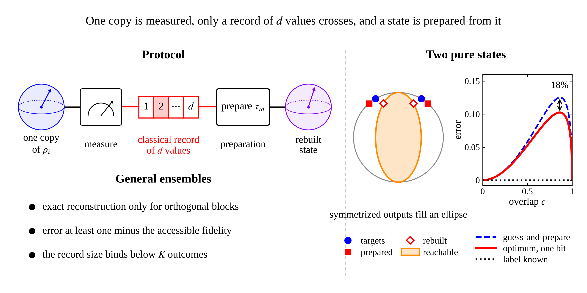

# Finite-classical-record quantum state reconstruction



Code and data for the manuscript

> W. Rahmaniar, *Finite-classical-record quantum state reconstruction: one-shot bounds and
> acquisition limits*, submitted to Quantum Information Processing.

The scripts reproduce every figure and every numerical value of the paper: the semidefinite
programs of Table 2, the checks behind Lemma 11, Theorem 12 and Proposition 13, the trine and
tetrahedral values of Sect. 5, and Figs. 1 to 5.

## Install and run

```
python -m pip install -r requirements.txt
python scripts/verify.py        # all checks; writes data/results_*.json
python scripts/make_figs.py     # writes figures/fig1_protocol.png ... figures/fig5_particle.png
```

Single sections and single figures can be selected, for example
`python scripts/verify.py two sdp` and `python scripts/make_figs.py 2 4`.
The figure script reads the stored results in `data/`, so the figures can be drawn without
running the numerics first. The output folder of the figures can be changed with the
environment variable `FIG_OUT`.

## What each file does

| File | Content |
|---|---|
| `scripts/verify.py` | Numerical checks and values, in six sections: `two` (Lemma 11, Theorem 12), `sdp` (Table 2), `perrun` (Proposition 13), `trine` and `sic` (Sect. 5), `misc` (Remark 14 and the mixed example after Corollary 8) |
| `scripts/make_figs.py` | Figs. 1 to 5 of the paper |
| `scripts/figstyle.py` | Shared figure style: one drawing width, serif text, STIX mathematics, one panel-label size and spacing |
| `data/results_*.json` | Stored results used by the figures and quoted in the text; fields in `data/README.md` |
| `figures/` | Output folder of `make_figs.py`, excluded from version control |
| `assets/graphical_abstract.png` | Graphical abstract shown above |

## Model

A target is drawn from an ensemble {p_i, ρ_i} of qubit states. A single copy is measured
with a positive operator-valued measure of d outcomes, only the outcome m is kept as a
classical record, and a state τ_m is prepared at the destination. The figure of merit is the
average trace distance Σ_i p_i D(ρ_i, Φ(ρ_i)) between each target and the output of the
resulting measure-and-prepare channel Φ.

* Measure-and-prepare channels on a qubit are exactly the channels whose Choi operator is
  positive under partial transposition, so the optimum over all record sizes is a
  semidefinite program; `verify.py` solves it in primal and dual form.
* For two pure targets of overlap c the optimum is V(c) of Theorem 12; `verify.py` checks
  the ellipse bound of Lemma 11 on random protocols with any number of outcomes and the
  analytic properties of V(c).
* For a fixed record size d the problem is not convex. The search parametrizes the
  measurement as Q_m = W^(-1/2) X_m† X_m W^(-1/2) with W = Σ_k X_k† X_k and the prepared
  states as τ_m = Y_m† Y_m / Tr(Y_m† Y_m), runs Powell minimization from random starts, and
  refines the best point by alternating semidefinite programs. It carries no global
  guarantee; the values at large d coincide with the certified semidefinite optimum.
* The visible problem, in which the drawn index is given to the encoder, is a d-point
  convex-hull approximation problem and is solved by direct search over the prepared
  states with exact distances to the convex hull.

## Reproducibility

Random numbers come from `numpy.random.default_rng` with fixed seeds, and the semidefinite
programs use the Clarabel solver with tolerances of 10^-12. The stored results were produced
with Python 3.13, NumPy 2.5.3, SciPy 1.18.1, CVXPY 1.9.3, Clarabel 0.11.1 and Matplotlib
3.11.2. A clean copy of this repository regenerates every file in `data/` byte for byte with
`verify.py`, in about 20 minutes (mostly the record-size searches of the `trine` and `sic`
sections), and every figure pixel for pixel with `make_figs.py`, in a few seconds. Each
section seeds its own random numbers, so a section run on its own reproduces its file as
well. The figures request Times New Roman and fall back to its metric twin Liberation Serif;
pixel-identical figures require the same font.

## Consistency checks

`verify.py` prints one line per check, PASS or FAIL, and ends with `ALL PASS`; a full run
performs 37 checks. They include the ellipse bound (20000 random protocols) and its
affine certificate (200000 random points of the unit ball), the uniqueness and strictness
statements of Theorem 12 and its small-overlap expansion, agreement of the semidefinite
program with V(c) at thirteen overlaps, the support function of the achievable set, the
per-run bound of Proposition 13 on 4000 random protocols and mixed pairs, the trine and
tetrahedral optima, accessible fidelities and baselines, and the Schmidt-basis value 1 − 1/n
of Remark 14.

## Citation

If you use this code, please cite the paper; `CITATION.cff` holds the details.

```
@article{Rahmaniar_FiniteRecord,
  author  = {Rahmaniar, Wahyu},
  title   = {Finite-classical-record quantum state reconstruction: one-shot bounds and
             acquisition limits},
  journal = {Quantum Information Processing},
  note    = {Submitted},
  year    = {2026}
}
```

## License

MIT; see `LICENSE`.
